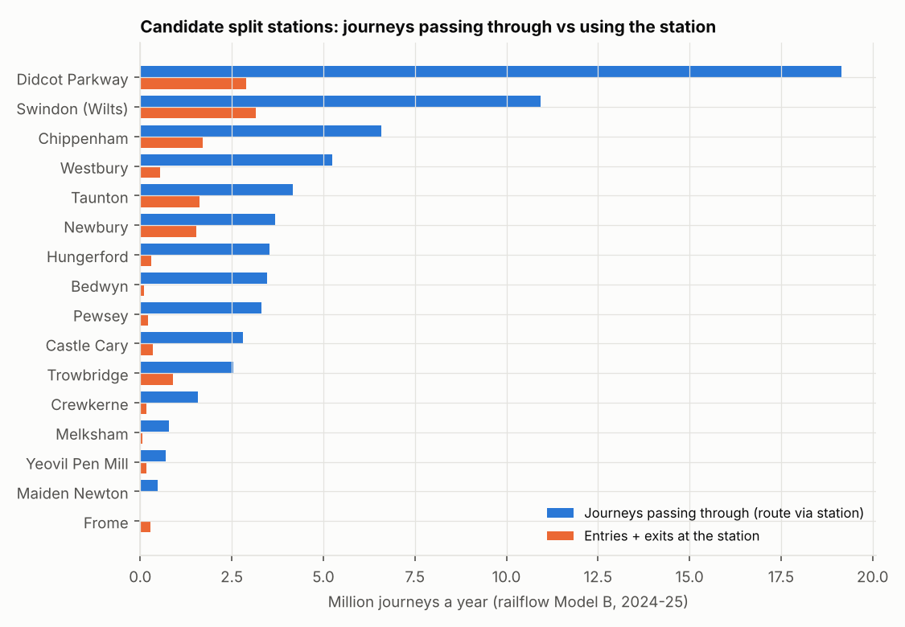
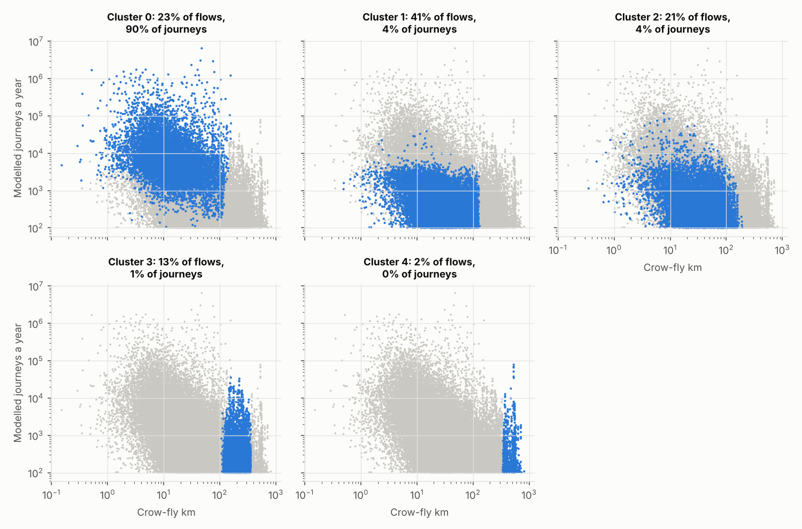
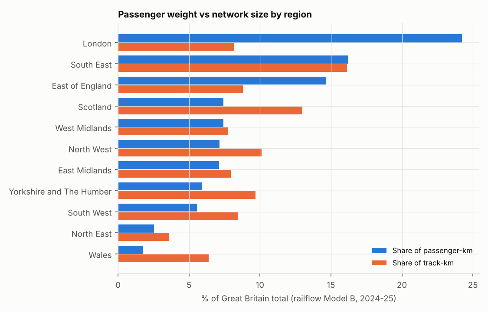

# Using railflow in other projects: worked examples

Prepared by Dr Rawle Prince · 25 October 2026 · railflow 0.1.0, base year ORR 2024-25 · Model description: [technical_document.html](technical_document.md) · Code: `examples/`

Three current AIIA projects work with rail flows but have no measure of how many passengers each flow, station or route carries. This page shows, with runnable examples on the current model, what railflow adds to each of them: the Split Ticket Calculator, the Flow Classification model and the T3 & Cancellation prediction work. The SWR Service Recovery project, the model's first user, has its own report.

### Summary

- **Split Ticket Calculator:** demand turns savings into revenue at risk. Weymouth–Melksham saves £121.70 per journey and carries about 349 journeys a year (upper bound £42k). Aldermaston–Betchworth carries almost none. Didcot Parkway and Swindon have far more journeys passing through than Pewsey, the STC's top split point.
- **Flow Classification:** railflow fills missing mileages with network distance for every flow and adds modelled journeys. Weighting by journeys changes the picture: one cluster holds 23% of flows but 90% of journeys.
- **T3 & Cancellation:** passenger-km weights by region and line for passenger-weighted performance targets and model training. London carries 24% of passenger-km on 8% of track; Scotland 7% on 13%.

## How projects use railflow

A project reads a model run through the read-only interface and keeps its own code and data in its own repository:

from railflow.api import RailFlow rf = RailFlow("path/to/railflow/outputs") T = rf.matrix("B", "ann") \# station x station journeys a year (Model B) rf.passing_through("PEW") \# OD pairs routed via Pewsey, with weekday trips rf.route_stations("WEY", "MKM") \# stations on the modelled route rf.screenline("VXH", "WAT") \# corridor flow between two stations print(rf.metadata\["version"\]) \# record next to project results

Each example below is a single script in `examples/` that runs in under a minute on a completed model run and writes CSV files and a figure to its own `outputs/` folder. Station pairs are keyed by CRS code; NLC codes are in `rf.stations.nlc` for joining to PMS or LENNON extracts.

**How much to trust the numbers.** Station-pair journeys are Model B estimates. For the 2,540 flows ORR publishes and for local-authority totals they match the data; for small and unpublished flows they are gravity-model infill and should be read as an order of magnitude. Route-level and regional totals are more reliable than any single small flow. See the validation section of the technical document.

## Split Ticket Calculator

### The project

The Split Ticket Calculator (STC) finds split-ticketing opportunities (STOs) in a price structure: for each origin–destination flow in the PMS data, it resolves the route with the network graph and Darwin services, tests feasible split stations where trains call, and reports the cheapest combination of tickets. It is being used for GWR fares work on Anytime Day Singles and Advance Singles. Its outputs rank opportunities by saving per journey. They do not say how many people travel on each flow, so a large saving on a flow nobody uses ranks the same as one on a busy flow.

### What railflow adds

1.  **Demand on every flow.** Annual journeys × saving gives an upper bound on revenue at risk if every traveller split their ticket. That ranks STOs by what they could cost, not by saving alone. `--stc summary_results.csv` joins the STC's primary output by origin and destination and writes the ranked list.
2.  **Journeys passing through each split station.** Every OD pair whose modelled route passes a station, with weekday and annual journeys. A station that is both a common split point and carries many through journeys is where split ticketing can cost most.
3.  **A route check.** The modelled route and its stations can be compared with the STC's route.

### Results

The STC's worked examples with modelled demand (both directions).

| STC example                           | Saving per journey | Journeys a year (Model B) | Upper-bound revenue at risk | Split station on modelled route | Route km |
|---------------------------------------|--------------------|---------------------------|-----------------------------|---------------------------------|----------|
| Weymouth–Melksham via Maiden Newton   | £121.70            | 349                       | £42,417                     | Yes                             | 109.8    |
| Aldermaston–Betchworth via Crowthorne | £2.80              | 0.1                       | £0.32                       | Yes                             | 81.3     |

The STC's two worked examples are very different once demand is attached. Weymouth–Melksham has a large saving and a modest but real flow, so it could be worth tens of thousands of pounds a year if every traveller split. Aldermaston–Betchworth has a small saving and almost no demand. The modelled Weymouth–Melksham route is 109.8 km, against 109.9 km from the STC's segment mileages (14.54 + 53.72 miles), and it passes Maiden Newton, the STC's split point.

<figure>

<figcaption>Candidate split stations on GWR routes in the STC analysis: journeys a year whose modelled route passes the station (blue) and the station's own entries and exits (orange). Frome shows no through journeys because the shortest track path bypasses the Frome loop; in the timetable many trains call there.</figcaption>
</figure>

Candidate split stations, ranked by journeys passing through.

| Station         | CRS | OD pairs routed through | Through journeys a year | Through journeys a weekday | Entries + exits a year |
|-----------------|-----|-------------------------|-------------------------|----------------------------|------------------------|
| Didcot Parkway  | DID | 699,484                 | 19.15m                  | 58,499                     | 2.88m                  |
| Swindon (Wilts) | SWI | 332,236                 | 10.93m                  | 33,316                     | 3.15m                  |
| Chippenham      | CPM | 121,566                 | 6.58m                   | 19,976                     | 1.71m                  |
| Westbury        | WSB | 194,958                 | 5.25m                   | 16,029                     | 0.54m                  |
| Taunton         | TAU | 301,044                 | 4.17m                   | 12,777                     | 1.62m                  |
| Newbury         | NBY | 89,984                  | 3.69m                   | 11,269                     | 1.54m                  |
| Hungerford      | HGD | 81,584                  | 3.52m                   | 10,731                     | 0.31m                  |
| Bedwyn          | BDW | 77,800                  | 3.46m                   | 10,540                     | 0.10m                  |
| Pewsey          | PEW | 75,050                  | 3.31m                   | 10,095                     | 0.21m                  |
| Castle Cary     | CLC | 115,076                 | 2.81m                   | 8,560                      | 0.35m                  |
| Trowbridge      | TRO | 138,266                 | 2.55m                   | 7,801                      | 0.90m                  |
| Crewkerne       | CKN | 134,202                 | 1.57m                   | 4,958                      | 0.18m                  |
| Melksham        | MKM | 76,570                  | 0.79m                   | 2,429                      | 0.06m                  |
| Yeovil Pen Mill | YVP | 64,314                  | 0.70m                   | 2,130                      | 0.17m                  |
| Maiden Newton   | MDN | 24,252                  | 0.47m                   | 1,430                      | 0.02m                  |
| Frome           | FRO | 0                       | 0.00m                   | 0                          | 0.29m                  |

Pewsey, the STC's top split point by both count and average saving, has 3.3 million journeys a year passing through it but only 209 thousand entries and exits. Didcot Parkway and Swindon carry several times as many through journeys, so even a lower split rate there could cost more. Combined with the STC's split counts, this gives a demand-weighted priority list for fares review.

### Caveats

- The upper bound assumes every traveller on the flow splits. Real take-up depends on retailer behaviour and awareness; the ranking is more useful than the absolute values.
- Model B gives all-ticket demand. The STC work is about Anytime Day Singles and Advance Singles, so a product split (roadmap R2, LENNON by ticket type) would sharpen the estimate.
- railflow routes on the shortest track path; the STC uses calling patterns. The two can disagree on loops and where several routes compete (Frome is the example here). Timetable-based routing (R3) removes the difference.

## Flow Classification

### The project

The preliminary Flow Classification model, part of the Integrated Fares Model work, grouped 15,072 PMS flows for London Overground and Greater Anglia into five clusters with k-means, using ticket types, mileage and station usage. Its stated limitations include missing or inconsistent mileages and no measure of journeys on each flow, with LENNON data planned.

### What railflow adds

- `network_km`: route distance on the rail network for every station pair, which fills missing mileages consistently.
- `crowfly_km`: straight-line distance, so circuitous flows can be identified.
- `annual_journeys` and `weekday_journeys`: modelled demand on the flow, in both directions.
- `commute_share`: season-ticket share of the two stations, weighted by their usage (a proxy until LENNON gives it by flow).

### Results

The example builds these features for all 44,041 station pairs touching a Greater Anglia or London Overground station with at least 100 modelled journeys a year (263 million journeys), runs a five-cluster k-means with distance weighted up as in the preliminary model, and reports each cluster's share of flows and of journeys.

<figure>

<figcaption>Each panel highlights one cluster (blue) against all flows (grey): crow-fly distance against modelled journeys a year, both on log scales.</figcaption>
</figure>

Cluster summary, ordered by median distance.

| Cluster | Flows  | Share of flows | Share of journeys | Median crow-fly km | Median network km | Median journeys per flow | Median commute share |
|---------|--------|----------------|-------------------|--------------------|-------------------|--------------------------|----------------------|
| 0       | 10,164 | 23%            | 90%               | 13                 | 18                | 5,625                    | 13%                  |
| 1       | 17,882 | 41%            | 4%                | 25                 | 33                | 338                      | 12%                  |
| 2       | 9,318  | 21%            | 4%                | 35                 | 48                | 362                      | 18%                  |
| 3       | 5,728  | 13%            | 1%                | 205                | 272               | 241                      | 12%                  |
| 4       | 949    | 2%             | 0%                | 517                | 643               | 223                      | 12%                  |

Clusters of similar size in flow counts are very different in demand. One cluster contains 23% of flows but 90% of journeys; the two long-distance clusters together hold 15% of flows and 1.9% of journeys. For fares decisions, where revenue and customer impact scale with journeys, cluster summaries should be weighted by journeys and the clustering itself can use journeys as a sample weight.

### How to use it

- Join `flow_features_ga_lo.csv.gz` to the PMS flow list on origin and destination CRS (or NLC via `rf.stations`). The PMS list has fewer flows because it holds priced flows only, while the example covers all station pairs with modelled demand.
- Use `network_km` where PMS mileage is missing, and the difference between the two as a data-quality flag.
- When LENNON is added, replace modelled journeys with observed ones and keep the network distance. The weekday ratio in the example is close to 1 for every cluster, because the current model derives it from station-level ticket mix; LENNON by flow and product (R2) would make it informative.

## T3 & Cancellation prediction

### The project

The T3 & Cancellation work tests whether indicator data (track quality, speed restrictions, vegetation, fleet reliability, signaller vacancies, right-time depot starts) predicts T3 (trains arriving within three minutes of schedule) and cancellations, using XGBoost on route-period metrics and SARIMAX for national forecasts. T3 and cancellations count trains. Passengers feel them in proportion to how many people are on the affected trains, which varies by an order of magnitude between routes. The project's PfPI definition (delay minutes that count against the passenger performance target) already points this way.

### What railflow adds

- **Passenger-weighted targets:** aggregate route-period T3 and cancellation rates to a national figure weighted by passenger-km, alongside the train-weighted one.
- **Sample weights or features:** passenger exposure per route as an XGBoost sample weight, so errors on busy routes count for more, or as a feature.
- **Impact conversion:** predicted cancellations × passengers per train on the route gives passengers affected for prioritisation.

### Results

<figure>

<figcaption>Share of GB passenger-km (blue) and of track-km (orange) by region. Each track section is assigned to the region of its nearest station.</figcaption>
</figure>

Passenger weights by region (Model B, 2024-25).

| Region                   | Passenger-km a year | Share of passenger-km | Share of track-km | Weekday passengers per track-km |
|--------------------------|---------------------|-----------------------|-------------------|---------------------------------|
| London                   | 15.5 bn             | 24.2%                 | 8.2%              | 16,410                          |
| South East               | 10.4 bn             | 16.2%                 | 16.1%             | 5,566                           |
| East of England          | 9.4 bn              | 14.7%                 | 8.8%              | 9,118                           |
| Scotland                 | 4.8 bn              | 7.4%                  | 13.0%             | 3,098                           |
| West Midlands            | 4.7 bn              | 7.4%                  | 7.8%              | 5,273                           |
| North West               | 4.6 bn              | 7.1%                  | 10.1%             | 3,868                           |
| East Midlands            | 4.6 bn              | 7.1%                  | 8.0%              | 4,869                           |
| Yorkshire and The Humber | 3.8 bn              | 5.9%                  | 9.7%              | 3,313                           |
| South West               | 3.6 bn              | 5.6%                  | 8.5%              | 3,588                           |
| North East               | 1.6 bn              | 2.5%                  | 3.6%              | 3,790                           |
| Wales                    | 1.1 bn              | 1.7%                  | 6.4%              | 1,476                           |

London carries 24% of passenger-km on 8% of track, and the South East and East of England are also heavy. Scotland, Wales and Yorkshire carry much less than their share of track. A train-weighted national T3 therefore gives a different answer from a passenger-weighted one whenever performance differs between these areas.

Ten named lines with the most passenger-km. The file has the top 40.

| Named line (OSM)        | Passenger-km a year | Share of GB passenger-km | Busiest section, weekday |
|-------------------------|---------------------|--------------------------|--------------------------|
| East Coast Main Line    | 9.45 bn             | 14.8%                    | 119,240                  |
| West Coast Main Line    | 6.84 bn             | 10.7%                    | 113,616                  |
| Great Western Main Line | 3.77 bn             | 5.9%                     | 155,292                  |
| South West Main Line    | 2.82 bn             | 4.4%                     | 213,638                  |
| Midland Main Line       | 2.54 bn             | 4.0%                     | 96,086                   |
| Brighton Main Line      | 2.13 bn             | 3.3%                     | 173,804                  |
| Great Eastern Main Line | 1.70 bn             | 2.7%                     | 194,897                  |
| Elizabeth Line          | 1.48 bn             | 2.3%                     | 145,732                  |
| South Eastern Main Line | 1.08 bn             | 1.7%                     | 192,616                  |
| South Wales Main Line   | 0.77 bn             | 1.2%                     | 25,667                   |

Weighting a route-period table takes two lines:

w = pd.read_csv("examples/performance_weighting/outputs/weights_by_region.csv").set_index("region").pkm_share df\["w"\] = df.area.map(w); national = (df.t3 \* df.w).groupby(df.period).sum() / df.w.groupby(df.period).sum()

### Caveats

- The project reports by Network Rail route, while the example uses ORR regions as a stand-in. Network Rail route boundaries are part of roadmap item R6; with them the same script gives weights by route directly.
- Weights are annual all-day passenger-km. Period (four-weekly) and peak weights need LENNON period data and time-of-day profiles (R2, R4).
- Passengers per train, needed to convert cancellations to passengers affected, comes with train-level assignment (R4). Until then, passenger-km divided by train-km from the SCHEDULE feed (R5 produces train counts) is a reasonable interim.

## SWR Service Recovery

The SWR Service Recovery proof of concept was the model's first application and is maintained in its own repository (`swr-service-recovery-flows`). It uses railflow for station throughput and screenline flows as the passenger exposure in incident models, to build a passenger-based location prior for the incident generator, to estimate passengers affected by incidents and recovery actions, and to weigh the cost of skipping stations in fail-to-stop decisions. Its report, *Network flows in the SWR Service Recovery POC*, describes the results.

## Next steps by project

| Project                 | Immediate use                                                                                                      | Improves with roadmap item                                                   |
|-------------------------|--------------------------------------------------------------------------------------------------------------------|------------------------------------------------------------------------------|
| Split Ticket Calculator | Run the example with `--stc summary_results.csv` on the GWR results; review the top of the revenue-at-risk ranking | R2 (demand by product), R3 (routing by calling pattern), R1 (observed flows) |
| Flow Classification     | Join network distance and modelled journeys to the PMS flows; report clusters by journeys                          | R1 and R2 (observed journeys by product and flow)                            |
| T3 & Cancellation       | Passenger-weighted national metrics; passenger-km sample weights                                                   | R6 (Network Rail routes), R4 and R5 (passengers and trains per route)        |
| SWR Service Recovery    | Location prior, exposure and skip-cost tables (in use)                                                             | R4 (passengers per train by time period), R5 (freight exposure)              |

## Sources

The full list for railflow, including the project pages these examples draw on, is in [sources.html](sources.md) and in the technical document.
