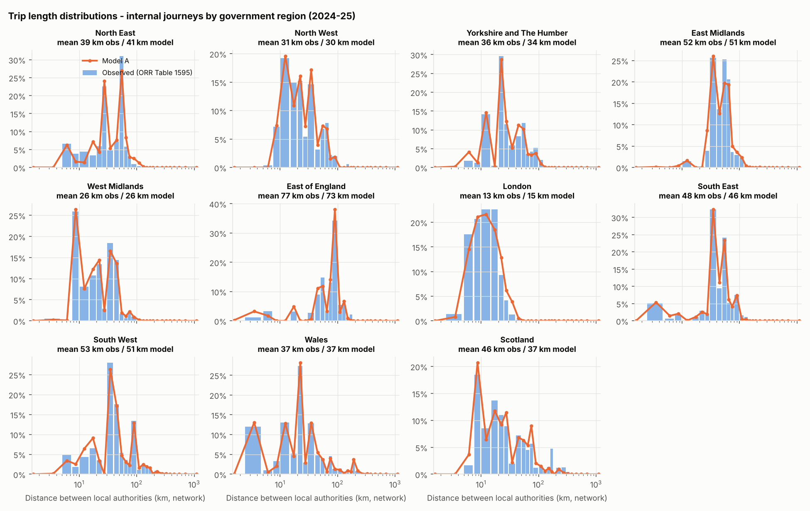
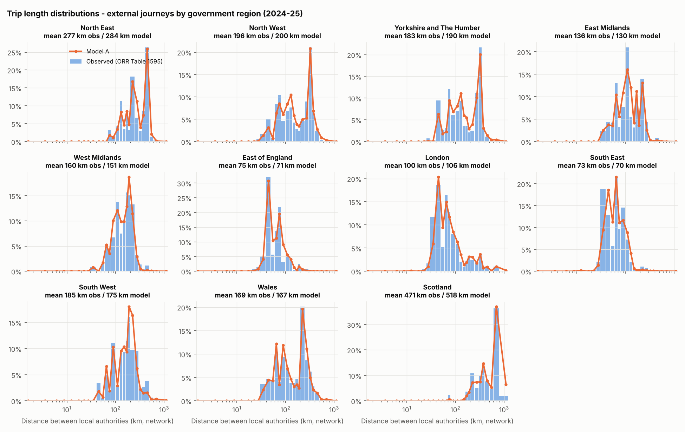
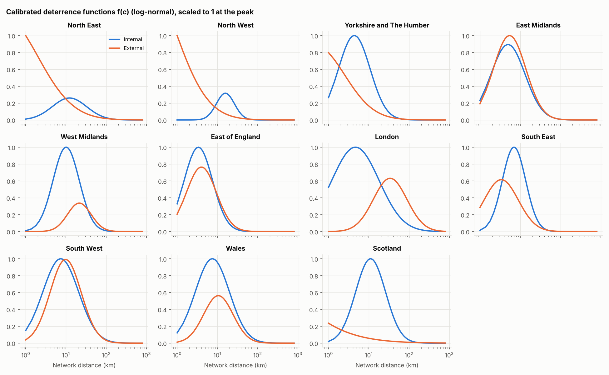
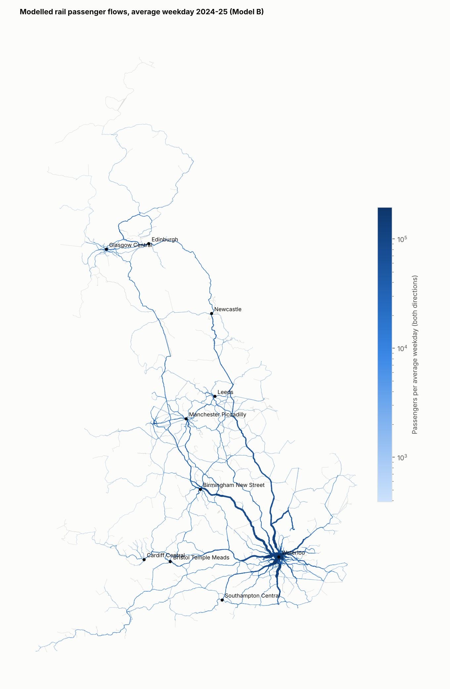
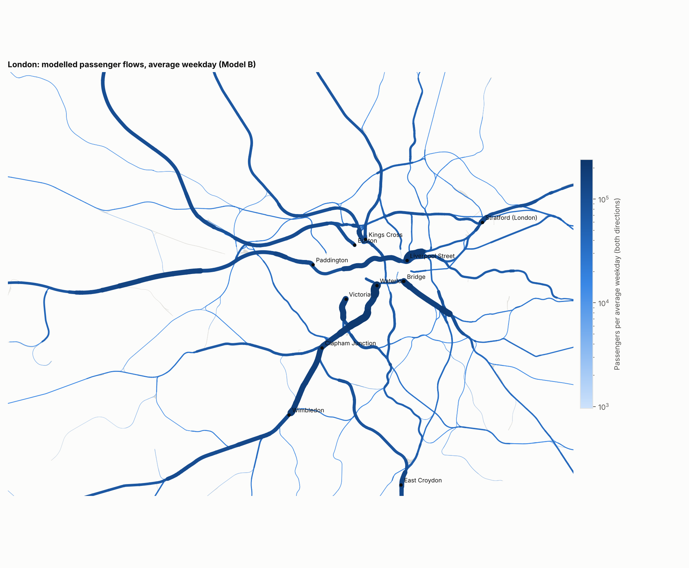
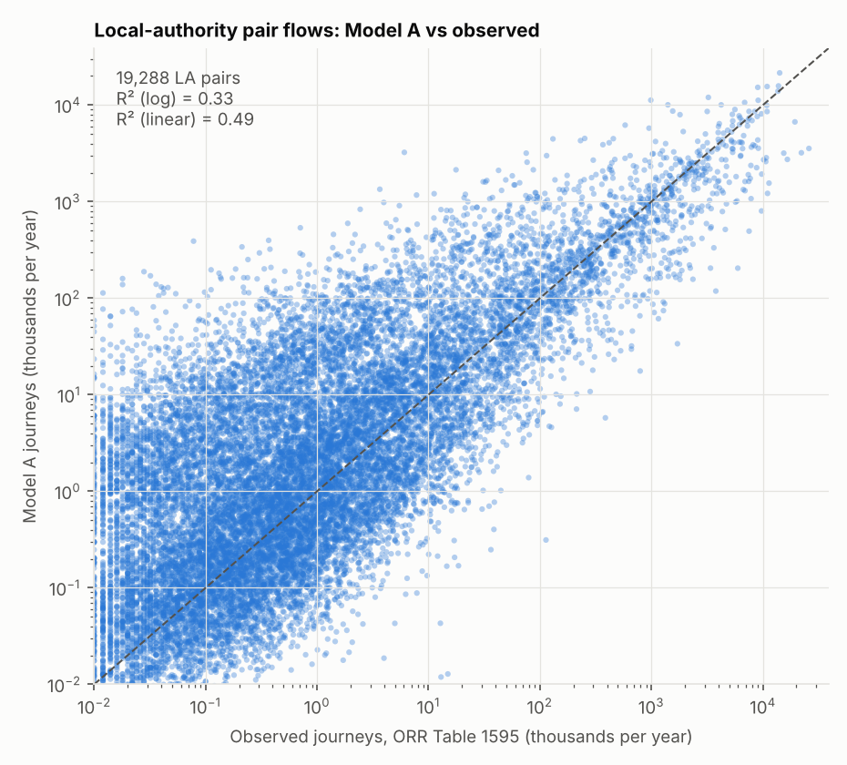

# railflow technical document

Prepared by Dr Rawle Prince · 25 October 2026 · Model version 0.1.0 · Base year ORR 2024-25 (April 2024 – March 2025) · Companion pages: [applications.html](applications.md), [sources.html](sources.md)

railflow estimates how many rail passengers travel between every pair of stations in Great Britain on an average weekday, and how those journeys load onto the rail network. It started inside the SWR Service Recovery proof of concept and is now a separate model, developed on its own release cycle and used by several projects. This document records how the model was built, how well it fits, how other projects use it, and how it should be improved.

### At a glance

- **Coverage:** 2,586 stations, 1,532 million journeys a year, **4.78 million on an average weekday**, on a 36,034 km rail network built from OpenStreetMap.
- **Two matrices.** *Model A* is a doubly constrained gravity model with 22 region-level deterrence functions, as in the ETC 2018 RailWatch paper. *Model B* fuses Model A with every station-pair and local-authority-pair count that ORR publishes. Model B is the default for network loading.
- **Fit:** regional trip-length distributions and internal shares are reproduced (mean error 0.4 pts). Passenger-km is 65.6 bn against ORR's 64.6 bn. Model B matches the 19,288 local-authority pair totals (R² 0.996) and the 2,540 published station main flows exactly.
- Main weakness: distance alone cannot reproduce the concentration of demand on fast direct services. Unpublished dominant flows are under-predicted: in a hold-out test, only 18% fall within ±25%. Observed station-to-station data (R1) and timetable-based costs (R3) are the two highest-priority improvements.
- **Use from other projects:** `from railflow.api import RailFlow` gives matrices, routes, flows through a station, screenline flows and re-assignment of any matrix. See [Outputs and interface](#outputs).

## Purpose and scope

Several GBRX and AIIA projects need the same thing: a defensible estimate of how many passengers use each station pair and each part of the network. Incident analysis needs it as an exposure measure, fares work needs it to weigh opportunities by demand, and performance work needs it to weight trains and routes by passengers. Building that separately in each project would give inconsistent numbers, so railflow is maintained as one model with a stable interface.

**In scope (version 0.1.0):** an all-day, average-weekday and annual station-to-station matrix for Great Britain in the ORR base year; shortest-path loading onto a GB rail network; station throughput and screenline flows; validation against ORR statistics; a Python interface for downstream projects.

**Not yet in scope:** time-of-day matrices, train-level loads, crowding, freight, forecasting and scenarios. All of these are on the [roadmap](#roadmap). The model describes the base year; it does not yet predict how demand responds to timetable or fare changes.

## Model at a glance

| Stage                | Module                     | Main inputs                                                                  | Main outputs                                                | Key choices                                                            |
|----------------------|----------------------------|------------------------------------------------------------------------------|-------------------------------------------------------------|------------------------------------------------------------------------|
| 1\. Trip ends        | `tripends.py`              | ORR Table 1410; station coordinates                                          | `stations.csv`: annual and weekday origins and destinations | O = D = half of entries + exits; weekday factors by ticket type        |
| 2\. Network          | `network.py`               | OSM railway lines                                                            | Graph, station nodes, station-to-station cost skim          | Four repair passes; unnamed ways ×1.25; central London transfer links  |
| 3\. Zones            | `zones.py`                 | Table 1595; OSM admin attribute                                              | Station → local authority → region                          | Checked against Table 1595 LA totals                                   |
| 4\. Distribution     | `distribution.py`          | Trip ends, skim, Table 1595 trip-length distributions, Table 1410 main flows | `matrices.npz`: Model A and Model B, annual and weekday     | 22 log-normal deterrence functions, jointly calibrated; Model B fusion |
| 5\. Validation       | `validation.py`            | Matrices; ORR tables                                                         | `validation_summary.json` and tables                        | LA-pair fit, hold-out of main flows, paper comparison                  |
| 6\. Assignment       | `assignment.py`            | Matrices; graph                                                              | Edge flows, GeoPackage, station throughput                  | All-or-nothing shortest path                                           |
| 7\. Exports, figures | `exports.py`, `figures.py` | All of the above                                                             | OD CSVs, figures                                            | –                                                                      |

A full run takes about 4 minutes when the stored deterrence parameters are reused, plus about 5 minutes when they are re-calibrated.

## Development history

railflow is the third implementation of the same modelling idea.

1.  **2017–2022, synthetic matrix calibration (R).** `Calibrate_Synthetic_ParmsNew.R` (version 1.4) fitted log-normal deterrence functions for several segments to observed trip-length distributions, alternating with a Furness run in EMME. The technical note *Estimating Parameters of Deterrence Functions in Synthetic Matrix Development* describes the method: calibration as non-linear least squares solved by Levenberg–Marquardt, with band merging above 160 bands and stratified sampling above 220,000 matrix cells to keep run times manageable.
2.  **2018, RailWatch Train Occupancy Model.** The ETC 2018 paper describes a three-stage Train Occupancy Model for the West Coast Main Line. Station trip ends came from NTS trip rates, Census population and NTEM, split to stations with ticket sales. A gravity model with 14 deterrence functions (seven regional groups, internal-to-internal and internal-to-external) was built from mobile network data trip-length distributions for four time periods, with NTEM origin and destination weights. Demand was assigned to individual trains from the CIF timetable, with a cost combining fare, time, crowding and wait.
3.  **October 2026, SWR Service Recovery POC.** The approach was rebuilt in Python with public data to give the incident analysis a passenger exposure measure.
4.  **October 2026, railflow 0.1.0.** The model was separated from the SWR project into its own repository with a command-line interface, a read-only Python interface and this document. Outputs are identical to the POC run.

### What changed from the RailWatch model, and why

| Component                      | RailWatch TOM (2018)                                                         | railflow 0.1.0                                                           | Reason                                                                                                                                                               |
|--------------------------------|------------------------------------------------------------------------------|--------------------------------------------------------------------------|----------------------------------------------------------------------------------------------------------------------------------------------------------------------|
| Trip ends                      | NTS trip rates × population × NTEM growth, split to stations by ticket sales | ORR Table 1410 entries and exits, converted to an average weekday        | Observed station usage is published for every station each year; a synthetic trip-end model is only needed for forecasting (R9)                                      |
| Trip-length targets            | Mobile network data, by time period                                          | ORR Table 1595 journeys between 200 local authorities, all day           | MND not available to the project; Table 1595 is the published LENNON-based matrix and totals exactly to Table 1410                                                   |
| Regions                        | 7 groups × 2 directions = 14 functions                                       | 11 ITL1 regions × 2 = 22 functions                                       | Table 1595 supports the full regional split; the 7-group results are reported for comparison                                                                         |
| Deterrence form                | Piecewise-linear, 1 km bands, not calibrated                                 | Log-normal with an external level term, calibrated                       | LA-level targets are too coarse for 1 km bands; a smooth form generalises better to station pairs. Piecewise forms remain an option (R8)                             |
| Origin and destination weights | NTEM time-period factors                                                     | Not used                                                                 | All-day model; needed for time periods (R8)                                                                                                                          |
| Calibration                    | Levenberg–Marquardt per segment, alternating with Furness                    | All 55 parameters fitted jointly, Furness re-run inside every evaluation | Vectorised Furness on the full 2,586 × 2,586 matrix takes well under a second, so no sampling or band merging is needed and segment interactions are handled exactly |
| Observed OD cells              | None                                                                         | Model B: 2,540 observed station flows fixed, LA-pair totals imposed      | Gravity models under-predict dominant radial flows; fusion uses every observation available                                                                          |
| Assignment                     | Schedule-based, to trains, with crowding                                     | All-or-nothing on track shortest paths                                   | Timetable not yet integrated (R3, R4)                                                                                                                                |

## Data

| Input (file in `data/`)                                                             | Provider and licence              | Used for                                                                                   | Refresh                            |
|-------------------------------------------------------------------------------------|-----------------------------------|--------------------------------------------------------------------------------------------|------------------------------------|
| Table 1410, entries, exits and interchanges by station, 2024-25 (`table-1410-…ods`) | ORR, Open Government Licence      | Trip ends by ticket type; main origin/destination flow per station; region; facility owner | Annually, each December            |
| Table 1595, journeys between local authorities, 2024-25 (`table-1595-…csv`)         | ORR, Open Government Licence      | Calibration targets; LA-pair totals for Model B; validation                                | Annually, with regional rail usage |
| OSM railways (`osm/railways_lines.shp`)                                             | HOT export of OpenStreetMap, ODbL | Network, distances, assignment; admin area for station-to-LA mapping                       | On demand                          |
| Station coordinates (`ext/stations.json`, `ext/uk-train-stations.csv`)              | davwheat and ellcom open lists    | Station locations by CRS code (second list as cross-check)                                 | When stations open                 |

Table 1595 totals 1,532 million journeys, the same as Table 1410, because both come from ORR's Origin-Destination Matrix (ODM), which is built from LENNON ticket sales with infill for Travelcards and local PTE tickets. The full station-to-station ODM is not published on the ORR portal but is available through the Rail Data Marketplace; it is roadmap item R1. `data/README.md` gives download links and checksums.

## Trip ends

Each journey appears once as an entry and once as an exit, so in an all-day matrix each station's origins and destinations are both half of its entries plus exits. Interchanges are not trip ends and are excluded. Annual figures are converted to an average weekday by ticket type:

- **Season tickets:** journeys made on working weekdays, annual ÷ 252.
- **Full and reduced-price tickets:** spread over the year with a day-of-week index (weekday 1.0, Saturday 0.9, Sunday and bank holiday 0.6), annual ÷ 334.8. Weekend travel has recovered faster than weekday travel since the pandemic, which is why Saturday sits close to a weekday.

The resulting national factor is 320: one average weekday carries 1/320 of annual journeys. Stations with more season-ticket use get a higher weekday share. These factors are the least certain input in the model. LENNON day-of-week data would replace them directly (R2), and they are set in `railflow/config.py`.

## Network and costs

The graph is built from shared OSM vertices, so lines meet only where OSM joins them, and bridges and tunnels stay separate. The HOT export is incomplete: some switch ways are missing, and whole sections are absent, including parts of the West Coast Main Line at Rugby, Settle–Carlisle and Bath–Bradford-on-Avon. Four repair passes make the network routable:

| Pass                           | Rule                                                                                                                                | Links | Length (km) | Cost                |
|--------------------------------|-------------------------------------------------------------------------------------------------------------------------------------|-------|-------------|---------------------|
| \(a\) Dead-end snaps           | Dead end joins the nearest vertex of another way within 30 m                                                                        | 6,710 | 61          | Length              |
| \(b\) Component bridges        | Remaining fragments join the main network (Borůvka-style, up to 40 km)                                                              | 280   | 924         | Length ×1.3         |
| \(c\) Named-line gaps          | Dead ends of the same named line are joined where the network detour exceeds 2.5 × gap + 2 km, using dead ends from before pass (a) | 238   | 2,196       | Length ×1.1         |
| \(d\) Central London transfers | Links among 26 central stations within 8 km, standing in for Underground and walk interchange                                       | 305   | 1,042       | 1.3 × length + 3 km |

The repaired graph has 156,247 OSM track sections (36,034 km) and is a single connected component. Costs are shortest-path track kilometres, with unnamed ways (mostly sidings, yards and depots) multiplied by 1.25 so routes stay on running lines. Each station snaps to the nearest named running line within 400 m, otherwise to the nearest vertex, and the snap distance is added as an access leg; 63 stations sit more than 1 km from any line. Station-to-station costs come from Dijkstra's algorithm over all station nodes.

On SWR routes the network distances are within 1–3% of timetable mileages: Waterloo–Southampton Central 127.4 km (127.8 km actual) and Waterloo–Exeter St Davids 277.4 km (277 km). The Weymouth–Melksham route used in the Split Ticket Calculator example is 109.8 km, against 109.9 km from the STC's segment mileages.

## Stations, local authorities and regions

Table 1595 is given between local authorities (LAs), so each station needs an LA. The OSM admin attribute provides it for most stations. Manual overrides cover cases where the attribute is wrong for ORR's purposes: for example Waterloo is in Lambeth, Tottenham Court Road in Camden, Luton Airport Parkway in Luton and Woolwich in Greenwich. A consistency step then makes each station's LA agree with its ORR region, and a greedy search reassigns stations under 3 million entries and exits where that brings LA totals closer to Table 1595. After this, 0.7% of entries and exits sit in a different LA from ORR's attribution, mostly in inner east London. Regions are the 11 ITL1 regions used by ORR.

## Model A: gravity distribution

The formulation follows Section 2.2 of the RailWatch paper and the technical note:

T_ij = A_i · B_j · O_i · D_j · f_k(c_ij) Σ_j T_ij = O_i, Σ_i T_ij = D_j (A, B from a symmetric Furness) internal pairs (same region r): f(c) = dlnorm(c; μ_r,int, σ_r,int) external pairs (regions r ≠ s): f(c) = sqrt( g_r(c) · g_s(c) ), g_r(c) = e^γ_r · dlnorm(c; μ_r,ext, σ_r,ext) c = max(network km, 1 km)

There is one deterrence function per region and direction: 11 regions × {internal-to-internal, internal-to-external} = **22 functions**, the log-normal density used in the R script. The level term eγ sets each region's internal/external split. Using the geometric mean of the two regions' external functions keeps the all-day matrix symmetric, as it should be when origins equal destinations.

### Calibration

The targets are 22 observed trip-length distributions (27 distance bands from 0 to 1,500 km, 2.5 km wide at the short end) plus 11 regional internal shares, 605 residuals in total, all built from Table 1595. Observed journeys sit between LA pairs, so the model's station-to-station matrix is aggregated to LA pairs and both are binned on the same journey-weighted network distance between LAs. This makes the comparison like for like. The 55 parameters are fitted jointly by bounded trust-region least squares (SciPy `least_squares`, method `trf`), with the Furness re-run at every evaluation. The objective fell from 270.1 to 5.65 in 738 evaluations (5 minutes). The parameters are stored in `outputs/model/theta.npy` and reused unless `--recalibrate` is given; a re-calibration from the same inputs reproduces them exactly.

<figure>

<figcaption>Internal-to-internal trip-length distributions by region: observed (bars) and Model A (line).</figcaption>
</figure>

<figure>

<figcaption>Internal-to-external distributions. They are multi-modal, as in the paper's Figure 4; the peaks come from where other regions' large stations sit, while the deterrence function itself stays smooth.</figcaption>
</figure>

Calibrated parameters (μ and σ on log-km) and fit to the observed regional distributions. Distances are between local-authority pairs.

| Region                   | μ int | σ int | μ ext | σ ext | γ ext | Internal share obs / model | Mean km int obs / model | Mean km ext obs / model |
|--------------------------|------------------------------------------------|------------------------------------------------|------------------------------------------------|------------------------------------------------|------------------------------------------------|----------------------------|-------------------------|-------------------------|
| North East               | 3.46                                           | 0.98                                           | 2.76                                           | 2.02                                           | 0.02                                           | 41% / 41%                  | 39 / 41                 | 278 / 286               |
| North West               | 3.03                                           | 0.52                                           | 1.56                                           | 1.91                                           | -0.10                                          | 70% / 70%                  | 31 / 30                 | 197 / 201               |
| Yorkshire and The Humber | 2.29                                           | 0.90                                           | 2.04                                           | 1.67                                           | -0.75                                          | 57% / 57%                  | 37 / 34                 | 183 / 191               |
| East Midlands            | 2.56                                           | 0.98                                           | 2.56                                           | 0.93                                           | 0.11                                           | 28% / 28%                  | 52 / 51                 | 137 / 130               |
| West Midlands            | 2.87                                           | 0.75                                           | 3.52                                           | 0.67                                           | -0.50                                          | 62% / 62%                  | 26 / 26                 | 160 / 152               |
| East of England          | 1.87                                           | 0.81                                           | 2.12                                           | 0.86                                           | -0.00                                          | 20% / 21%                  | 77 / 74                 | 76 / 71                 |
| London                   | 3.37                                           | 1.35                                           | 4.44                                           | 0.96                                           | 0.73                                           | 63% / 62%                  | 14 / 15                 | 100 / 106               |
| South East               | 2.40                                           | 0.67                                           | 2.18                                           | 0.98                                           | -0.58                                          | 29% / 29%                  | 48 / 46                 | 73 / 70                 |
| South West               | 3.05                                           | 1.03                                           | 3.07                                           | 0.89                                           | 0.00                                           | 50% / 51%                  | 53 / 52                 | 186 / 176               |
| Wales                    | 2.97                                           | 0.98                                           | 3.06                                           | 0.84                                           | -0.51                                          | 65% / 64%                  | 37 / 38                 | 170 / 168               |
| Scotland                 | 3.14                                           | 0.86                                           | 6.90                                           | 3.86                                           | -1.12                                          | 87% / 87%                  | 46 / 38                 | 475 / 525               |

<figure>

<figcaption>Calibrated deterrence functions, scaled to their peak. Most internal functions peak between 5 and 30 km, because very short station-to-station trips are rare by rail. London's internal function is the flattest over 2–40 km.</figcaption>
</figure>

## Model B: fusing the gravity model with ORR observations

A distance-only gravity model spreads each station's trips across nearby stations. Real rail demand is more concentrated, because fast direct services make a London terminus effectively closer than the next town. Model A gives Surbiton–Waterloo 0.26 million journeys a year, where ORR records 3.61 million. No distance function can fix this, so Model B uses the observations directly:

1.  The 2,540 unique station *main origin/destination* flows in Table 1410 are fixed cells. Each station's largest flow is published, and together these carry 41% of all journeys.
2.  All other cells start from Model A and are balanced to each station's remaining trip ends and to the remaining LA-to-LA totals of Table 1595, by tri-proportional fitting with symmetry imposed at each iteration. After 150 iterations the residual error is 4.4% on LA pairs and 0.2% on trip ends.
3.  The weekday matrix applies Model A's cell-by-cell weekday/annual ratio to Model B and is re-balanced to weekday trip ends.

In Model B the gravity model's job is infilling: it distributes the roughly 60% of journeys that ORR does not publish at station level, within observed LA-pair totals. Model B is the recommended matrix for network loading, because it gets the large published flows right and those dominate link loads.

## Assignment and derived measures

Both matrices are assigned all-or-nothing to the shortest network path. Each origin's shortest-path tree is built once, and every destination's demand is pushed back up the tree (a Numba-compiled loop), so the full GB assignment takes about a minute. Flows are two-way passengers on each OSM track section, per average weekday and per year. Where OSM maps parallel tracks separately, the route uses one of them, so a single line on the map carries the corridor total. Two derived measures avoid that artefact:

- **Station throughput:** passengers per weekday who use a station or pass through it, counted on a 150 m ring around the station so that all parallel tracks are included (`station_throughput.csv`).
- **Screenlines:** two-way flow crossing a line drawn across all tracks midway between two stations (`RailFlow.screenline`).

<figure>

<figcaption>Great Britain, Model B, average weekday. Line width is proportional to two-way passengers.</figcaption>
</figure>

<figure>

<figcaption>London, Model B, average weekday.</figcaption>
</figure>

Busiest named lines (at least 50 km of track): highest two-way weekday flow on any section of the line.

| Named line (OSM)        | Track km | Peak section, Model B | Peak section, Model A |
|-------------------------|----------|-----------------------|-----------------------|
| South West Main Line    | 764      | 213,638               | 184,094               |
| Great Eastern Main Line | 330      | 194,897               | 210,575               |
| South Eastern Main Line | 286      | 192,616               | 170,499               |
| Brighton Main Line      | 314      | 173,804               | 136,493               |
| Great Western Main Line | 687      | 155,292               | 132,766               |
| High Speed 1            | 205      | 148,434               | 188,171               |
| Elizabeth Line          | 116      | 145,732               | 155,400               |
| East Coast Main Line    | 1,702    | 119,240               | 129,228               |
| West Coast Main Line    | 1,580    | 113,616               | 108,334               |
| Midland Main Line       | 855      | 96,086                | 93,605                |

## Validation

| Test                                                  | Model A     | Model B | Note                             |
|-------------------------------------------------------|-------------|---------|----------------------------------|
| Regional internal share, mean absolute error          | 0.4 pts     | –       | Calibration target               |
| LA-pair flows (19,288 pairs), R² linear / log         | 0.49 / 0.33 | 0.996   | B is fitted to these             |
| LA pairs over 100,000 journeys: median absolute error | 50%         | –       | 1,131 pairs                      |
| Held-out main station flows (526 pairs): within ±25%  | 18%         | 18%     | B rebuilt from the other 80%     |
| Held-out main station flows: median model ÷ observed  | 0.31        | 0.38    | 1.00 = unbiased                  |
| Mean journey length (passenger-km ÷ journeys)         | 42.7 km     | 42.8 km | ORR: 37.4 km (all operators)     |
| Passenger-km per year                                 | 65.5 bn     | 65.6 bn | ORR: 64.6 bn for 1,729m journeys |

<figure>

<figcaption>Model A against observed LA-pair flows. Scatter is wide for small pairs and tighter for the large flows that dominate network loads.</figcaption>
</figure>

**Interpreting the hold-out.** One in five published main flows was withheld, Model B rebuilt from the rest, and the withheld flows compared with the model. Both models under-predict them by a factor of two to three (median ratio 0.38 for B). Balancing to LA totals alone, with no fixed cells, does a little better: 22% within ±25%, median ratio 0.49. Fixing the other 80% of main flows uses up much of each London terminal's trip ends, which leaves less for the withheld pairs. The under-prediction is structural: distance does not capture service quality. Hub uplifts and gateway rules were tested during development and did not fix it. Timetable-based costs (R3) and observed station-to-station flows (R1) do.

**Passenger-km.** Modelled passenger-km match ORR's total closely, but ORR's figure covers 13% more journeys (1,729m, including journeys not in station usage, against 1,532m). Modelled journeys are therefore about 15% longer than ORR's average (42.8 km against 37.4 km), which fits shortest paths on a repaired network with access legs and cross-London transfer links. Treat absolute link loads as indicative (±15–25%). Relative loads between corridors are more robust.

### Comparison with the RailWatch paper's Table 1

Mean station-to-station trip lengths for the paper's seven regional groups (Model B). The paper's figures are AM-peak trips from mobile network data in 2018, and its distributions stop at about 200 km, so they are context rather than a target. The broad ordering is the same: London has the shortest internal trips, and Scotland, Yorkshire & North, Wales and the Midlands have the longest external trips. Internal means are shorter here because all-day travel includes many short off-peak trips, and external means are longer for distant regions because long trips are not truncated.

Mean trip length (km): railflow Model B, all day 2024-25; paper, AM peak 2018.

| Group             | Internal, railflow | Internal, paper | External, railflow | External, paper |
|-------------------|--------------------|-----------------|--------------------|-----------------|
| East of England   | 23                 | 57              | 69                 | 110             |
| English Midlands  | 29                 | 49              | 149                | 219             |
| London            | 13                 | 20              | 94                 | 134             |
| Scotland          | 41                 | 53              | 446                | 218             |
| South of England  | 32                 | 68              | 78                 | 117             |
| Wales             | 28                 | 45              | 166                | 177             |
| Yorkshire & North | 34                 | 63              | 245                | 183             |

## Outputs and interface

### Files written by a run

| File (under `outputs/`)                                                           | Content                                                                                                                                                                                                                                                 |
|-----------------------------------------------------------------------------------|---------------------------------------------------------------------------------------------------------------------------------------------------------------------------------------------------------------------------------------------------------|
| `model/stations.csv`                                                              | One row per station in model order: CRS, NLC, name, region, facility owner, coordinates (lat/lon and BNG), entries and exits by ticket type, weekday entries and exits (`ee_awd`), season share, origins and destinations (`O_awd`, `D_awd`), main flow |
| `model/matrices.npz`                                                              | `TA_ann`, `TA_awd`, `TB_ann`, `TB_awd`: station × station trips (float32), rows are origins in `stations.csv` order                                                                                                                                     |
| `model/skim_cost_km.npy`                                                          | Station × station network cost (km), including access legs and penalties                                                                                                                                                                                |
| `model/net_edges.parquet`, `model/net_nodes.npy`                                  | Network graph (edges with kind `osm`, `snap`, `bridge`, `gap`, `tube`; cost and geometry in BNG)                                                                                                                                                        |
| `model/edge_flows.parquet`                                                        | Edges with `flow_TA_awd`, `flow_TB_awd`, `flow_TA_ann`, `flow_TB_ann`                                                                                                                                                                                   |
| `model/station_nodes.csv`, `model/station_la.csv`, `model/station_throughput.csv` | Station node and snap distance; LA and region; use + through flows                                                                                                                                                                                      |
| `model/theta.npy`, `model/calibration.json`, `model/metadata.json`                | Calibrated parameters; calibration and fusion statistics; version, run time and assumptions                                                                                                                                                             |
| `od_matrix_awd_modelA.csv.gz`, `od_matrix_awd_modelB.csv.gz`                      | Long-format weekday OD (pairs ≥ 0.05 trips a day, over 99% of trips)                                                                                                                                                                                    |
| `gis/rail_flows.gpkg`                                                             | Flows for GIS (WGS84)                                                                                                                                                                                                                                   |
| `tables/*.csv`, `figures/*.png`                                                   | Parameters, validation tables and the figures in this document                                                                                                                                                                                          |

### Python interface

Downstream projects read a run through `railflow.api.RailFlow`, which is read-only and does not depend on how the model was built. Station order is the same everywhere.

| Call                                                      | Returns                                                                                         |
|-----------------------------------------------------------|-------------------------------------------------------------------------------------------------|
| `rf = RailFlow("outputs")`                                | Handle on a model run                                                                           |
| `rf.stations`, `rf.crs`, `rf.idx("WAT")`                  | Station table (with LA, throughput, node); CRS codes; matrix index of a CRS or list of CRS      |
| `rf.matrix("B", "awd")`                                   | S × S trips; model `"A"` or `"B"`, period `"awd"` or `"ann"`                                    |
| `rf.od("B", "awd", min_trips=0.05)`                       | Long table of station pairs with trips and network km                                           |
| `rf.skim`                                                 | S × S network cost (km)                                                                         |
| `rf.route_stations("WEY", "MKM")`, `rf.route_edges(o, d)` | Stations on the modelled route, in order; edge ids of the route                                 |
| `rf.passing_through("PEW")`                               | OD pairs whose modelled route passes a station, with trips                                      |
| `rf.screenline("VXH", "WAT")`                             | Two-way flow across all tracks between two stations                                             |
| `rf.edges`, `rf.assign(T1, T2, …)`                        | Edge flows (GeoDataFrame); edge flows for any S × S matrices, for example one segment of demand |

Projects should record the model version they used (`rf.metadata["version"]`) next to their results, so a later model release does not silently change them.

## Running and configuring

pip install -e . \# Python 3.11+ python -m railflow run --data data --out outputs \# full run (stored parameters reused) python -m railflow run --recalibrate \# re-fit the deterrence functions python -m railflow run --steps assignment,figures \# selected steps only python -m railflow info --out outputs \# summary of a run

All assumptions that are not read from data (weekday factors, cost penalties, minimum distance, regions, map extents) are in `railflow/config.py`. Network repair settings are constants at the top of `railflow/network.py`. A run records its version, Python version, step times and key assumptions in `outputs/model/metadata.json`. Step times for this run: trip ends 3 s; network 49 s; zones 9 s; distribution 22 s; validation 36 s; assignment 76 s; exports 9 s; figures 9 s.

### Versioning and releases

- Version numbers follow *major.minor.patch*. A change to outputs for the same inputs (a method change) is a minor release; a new base year of ORR data is a minor release; a change to the interface that breaks downstream code is a major release.
- Each release regenerates this document from its own outputs with `python docs/build_docs.py`, so numbers in the text always match the run.
- ORR publishes station usage each December and regional rail usage around the same time. An annual refresh replaces Tables 1410 and 1595, re-runs with `--recalibrate` and compares outputs with the previous year.

## Limitations

- **Distance-only costs.** The deterrence functions use network km. Service frequency, journey time, interchange and fares are missing, which is the cause of the under-predicted dominant flows (R1, R3).
- **All-day, symmetric matrices.** Directional peak flows and time-of-day profiles need time-period modelling (R2, R8).
- **Assumed weekday factors.** The conversion from annual to weekday uses assumed day-of-week indices (R2).
- **Shortest-path routing.** Passengers are routed on the shortest track path, not on the trains they would take. Loops that the shortest path bypasses get no through flow: Frome, for example, sits on a loop off the Westbury–Castle Cary line that many trains use (R3, R4).
- **Network gaps.** 2,196 km of named-line gap links and 924 km of bridges stand in for track missing from the OSM export (R6).
- **Station groups and London.** Tickets to station groups and cross-London journeys are represented only through ORR's allocation and coarse transfer links (R7).
- **Passengers only.** Freight is not modelled (R5).

## Improvement roadmap

The items below are ordered by value to the projects that use the model and by how directly they address the known weaknesses. Each is designed to be delivered as a separate minor release, with validation before and after.

| ID  | Improvement                                                         | Fixes                                               | Data                                                       | Effort          | Priority                    |
|-----|---------------------------------------------------------------------|-----------------------------------------------------|------------------------------------------------------------|-----------------|-----------------------------|
| R1  | Observed station-to-station OD (ORR ODM)                            | Under-predicted dominant flows; infill quality      | ODM via Rail Data Marketplace                              | Small–medium    | 1 |
| R2  | LENNON variations: ticket type, day of week, period                 | Assumed weekday factors; segmentation               | LENNON extracts (industry access)                          | Medium          | 1 |
| R3  | Timetable-based generalised cost                                    | Distance-only costs; routing via loops              | Network Rail SCHEDULE feed (CIF/JSON); fares               | Medium–large    | 1 |
| R4  | Schedule-based assignment to trains, with time periods and crowding | No train loads; no time of day                      | SCHEDULE feed; train formations; departure profiles        | Large           | 2 |
| R5  | Freight services                                                    | No freight exposure                                 | SCHEDULE FREIGHT file; TRUST movements; ORR freight tables | Medium          | 2 |
| R6  | Network Rail network model                                          | OSM gaps; no ELR or route boundaries                | network-rail-gis (OGL); TIPLOC locations                   | Medium          | 2 |
| R7  | Station groups and cross-London travel                              | London Terminals and other groups; crude transfers  | ODM group allocation; Underground links                    | Small–medium    | 3 |
| R8  | Distribution refinements                                            | Functional form; time periods; segmentation         | NTEM 8 OD factors; R1, R2                                  | Medium          | 3 |
| R9  | Trip-end model for scenarios                                        | No forecasting                                      | NTEM 8; population and employment; elasticities            | Medium–large    | 3 |
| R10 | Validation and uncertainty                                          | Link loads unchecked against counts; no error bands | Passenger counts; ODM hold-outs                            | Medium, ongoing | 2 |
| R11 | Engineering: tests, CI, data versioning                             | Reproducibility as more people contribute           | –                                                          | Small, ongoing  | 1 |

### R1. Observed station-to-station OD from the ORR Origin-Destination Matrix

ORR builds an Origin-Destination Matrix (ODM) of estimated journeys between every pair of mainline stations each year, and station usage is derived from it. Annual ODM datasets from 2018-19 onwards are available on the Rail Data Marketplace, and regional bodies already use extracts (for example Transport for the South East's 2022-23 ODM). With the ODM:

- Model B's fixed cells grow from 2,540 main flows to every observed pair. The gravity model is then needed only for pairs below ORR's reporting threshold and for future scenarios.
- The deterrence functions can be calibrated at station-pair level instead of LA level, with finer distance bands, which allows piecewise forms as in the paper (R8).
- The hold-out test becomes a proper cross-validation: withhold a random 20% of station pairs and score the infill.

**Implementation:** add `railflow/odm.py` to read the ODM into the station index (mapping NLC to CRS, including station groups), extend `fuse()` to take any set of fixed cells, and keep LA totals as a constraint for pairs below the threshold. **Check:** ODM licence terms for sharing derived outputs between projects.

### R2. LENNON variations: ticket type, day of week and period

LENNON is the industry ticketing and revenue system behind the ODM. It records sales by flow and product, which ORR converts to journeys with ticket-type journey factors (for example 480 journeys per annual season ticket). Extracts by flow would add:

- **Ticket-type segmentation.** Separate matrices for season, full and reduced-price tickets, each with its own deterrence functions and weekday factor. Commuting and leisure trips have very different trip-length distributions, and several projects need the split: fares work by product, and incident impact by commuter or leisure share.
- **Day-of-week factors.** Where an extract carries the date of travel or validity (day tickets, Advance tickets), day-of-week profiles replace the assumed Saturday and Sunday indices in `config.py`, by region or flow type.
- **Periods of the year.** Four-weekly figures give seasonal factors, so a "typical weekday in period 8" can be modelled for incident or performance work.

LENNON records sales, not the time a journey was made, so time-of-day profiles need other sources: gate-line data, passenger counts, Advance-ticket reservations or NTS time-of-day distributions. **Implementation:** a `segment` dimension in the trip ends and matrices (`matrices.npz` keys such as `TB_awd_season`), with the interface defaulting to the all-segment total so existing users are unaffected.

### R3. Timetable-based generalised cost

The single most important method change. Network Rail's open SCHEDULE feed provides every planned passenger and freight schedule (JSON or CIF; full extracts plus daily updates), with calling points by TIPLOC, times and days of operation. From it:

1.  Build a service network for a representative weekday (permanent schedules with overlays and cancellations applied).
2.  Compute, for each station pair and period, the in-vehicle time, the service interval (headway), the number of interchanges and the interchange wait, using a time-dependent shortest path or frequency-based skims.
3.  Combine them into generalised journey time (GJT): in-vehicle time + a service interval penalty + an interchange penalty, following standard rail demand practice (PDFH). Fares from the RSP fares feed or PMS can be added as a money term for segments where price matters.
4.  Replace network km with GJT in the deterrence functions and recalibrate. Distance stays available as a second cost for validation.

Fast, frequent direct services to London termini then appear as short generalised costs, which is what concentrates demand on them. This addresses the hold-out under-prediction at source and also routes passengers via the stations their trains actually call at (Frome, for example). **Dependencies:** TIPLOC-to-network mapping (R6, or the YA_Tiploc_List coordinates as an interim).

### R4. Schedule-based assignment, time periods and crowding

The RailWatch model assigned demand to individual trains (Section 2.3 of the paper), with a cost combining fare, time, a crowding term that rises as passengers approach capacity, and wait time. Rebuilding this on R3's service network gives:

- Passengers on each train and train segment, by time period, so the passengers affected by a cancelled or delayed train can be read directly. This is the measure the SWR recovery recommender and passenger-weighted performance analysis need.
- Time-period matrices (AM, inter-peak, PM, off-peak) from departure-time profiles (R2 sources) and, for direction, production–attraction to origin–destination conversion for commuting segments.
- Crowding and capacity, once train formations are attached to schedules.

A frequency-based or schedule-based transit assignment with capacity restraint is the standard method. Start with an uncapacitated assignment to the fastest services, which is much simpler and already gives train loads.

### R5. Freight services

Freight shares infrastructure with passenger services and contributes to infrastructure wear and to reactionary delay, but it is absent from the model. The SCHEDULE feed publishes freight schedules in a separate FREIGHT file (JSON). From it:

- Load freight paths onto the network to give freight trains per section per weekday, by commodity sector where the operator and train characteristics allow.
- Compare with TRUST movement data for trains that actually ran, since many freight paths are conditional and run only when required.
- Control to ORR freight statistics (Table 1330 freight trains run, Table 1333 freight train km by operator).

Freight trains per section become a second exposure measure next to passengers, for incident models and performance prediction. Passenger-train counts per section come from the same pass and are useful in their own right.

### R6. Network Rail network model

The OSM export needed 2,196 km of gap links and 924 km of bridges. Network Rail's track, reference line and organisational boundary data is published on GitHub (openraildata/network-rail-gis) under the Open Government Licence and updated quarterly. Moving to it would:

- remove the synthetic links and give correct junction topology;
- attach Engineer's Line References (ELRs) and mileages to edges, which is how Network Rail and TRUST locate assets and incidents;
- provide Network Rail route and region boundaries, so flows can be summarised by the routes used in performance reporting (T3 and cancellations are reported by route).

Keep OSM as a fallback and for station platforms and names. Add TIPLOC and STANOX locations as network nodes so schedules (R3, R5) and TRUST delay records can be joined to edges.

### R7. Station groups and cross-London travel

Tickets sold to station groups such as London Terminals are split between stations by ORR using routing models, and journeys wholly within the Travelcard area are allocated with Oyster data. railflow inherits those allocations through Table 1410 but routes cross-London journeys over 305 coarse transfer links. Explicit Underground and Elizabeth line interchange links with walk and wait times, and use of the ODM's group-level flows, would improve flows on the London approaches and the London Overground.

### R8. Distribution refinements

- **Functional form.** Test piecewise (non-parametric) deterrence functions as in the RailWatch model once targets are at station level (R1); keep the log-normal as the default if it validates as well.
- **Time-period weights.** Introduce the paper's origin and destination weights Wi, Wj from NTEM 8 time-period factors to build AM, inter-peak and PM matrices.
- **Segmentation** by ticket type (R2), with separate calibration.
- **Service-quality terms.** If GJT (R3) is not yet available, a station attractiveness term from direct services to major destinations can be tested, calibrated on the ODM.

### R9. Trip-end model for scenarios

Observed trip ends describe the base year only. For "what if" work (new stations, timetable changes, demand recovery), add a trip-end model in the RailWatch style: NTEM 8 growth by area and scenario, population and employment within station catchments, and elasticities to GJT and fares from PDFH. Base-year trip ends stay observed; the model only produces changes.

### R10. Validation and uncertainty

- Compare link loads with passenger counts on a sample of corridors (operator load counts or gate-line data, where projects can obtain them). This is the main gap in validation today.
- Score each release on a fixed validation set: ODM hold-out, LA pairs, regional passenger-km and screenlines, so changes are visible in the change log.
- Estimate uncertainty by re-running with perturbed weekday factors and bootstrapped calibration targets, and publish ranges for screenline flows.

### R11. Engineering

- Tests: version 0.1.0 has core checks in `tests/test_core.py` (Furness margins, shortest-path assignment and passenger-km conservation). Add tests for the fusion and an end-to-end run on a small synthetic network.
- Continuous integration that runs tests and checks a stored run reproduces published numbers.
- Data manifest with source URLs and SHA-256 checksums for every input (`data/README.md`), and model outputs attached to GitHub releases so projects can pin a version without re-running.
- Keep `railflow.api` backwards compatible within a major version.

### Suggested sequence

1.  **Release 0.2:** R11 basics and R1 (ODM fusion). Largest accuracy gain for the effort, and it does not change the interface.
2.  **Release 0.3:** R2 segmentation and day-of-week factors.
3.  **Release 0.4:** R6 network, then R3 generalised cost and recalibration.
4.  **Release 0.5 onwards:** R4 train-level assignment and time periods, and R5 freight. R7–R10 alongside.

## Change log

| Version | Date         | Change                                                                                                                                                                                                                                                                                                                  |
|---------|--------------|-------------------------------------------------------------------------------------------------------------------------------------------------------------------------------------------------------------------------------------------------------------------------------------------------------------------------|
| 0.1.0   | October 2026 | First release as an independent model, separated from the SWR Service Recovery POC. Package `railflow` with CLI and read-only interface; calibration and fusion statistics written to `calibration.json`; metadata recorded after each step; outputs identical to the POC run. Examples for three projects; core tests. |

## Sources

The same list is published as a separate page: [sources.html](sources.md).

### Method references (supplied with the project)

1.  *Real-time estimation of train occupancies using mobile phone data (RailWatch)*. Prince, R. and Perret, P., Citi Logik Ltd. European Transport Conference 2018, AET.  
    Used for: Train Occupancy Model: trip-end model, gravity distribution with multiple region-level deterrence functions (Section 2.2, Table 1), schedule-based assignment (Section 2.3).
2.  *Estimating Parameters of Deterrence Functions in Synthetic Matrix Development (technical note)*. Prince, R., AECOM. Technical note (PDF dated March 2022).  
    Used for: Calibration as non-linear least squares (Levenberg–Marquardt) of deterrence parameters against trip-length distributions.
3.  *Calibrate_Synthetic_ParmsNew.R (version 1.4, multiple deterrence functions)*. Prince, R.. R script, 2017.  
    Used for: Log-normal deterrence form (dlnorm) and multi-segment calibration logic.

### Office of Rail and Road (ORR)

4.  [Table 1410: Passenger entries, exits and interchanges by station, April 2024 – March 2025](https://dataportal.orr.gov.uk/media/msigcn24/station-usage-2024-25-statistical-release.pdf). ORR. Estimates of station usage 2024-25 (statistical release).  
    https://dataportal.orr.gov.uk/media/msigcn24/station-usage-2024-25-statistical-release.pdf  
    Used for: Station trip ends by ticket type; main origin/destination flow per station; station region and facility owner.
5.  [Table 1595: Passenger journeys between local authorities](https://dataportal.orr.gov.uk/statistics/usage/regional-rail-usage/table-1595-passenger-journeys-between-local-authorities/). ORR. Regional rail usage, April 2024 – March 2025.  
    https://dataportal.orr.gov.uk/statistics/usage/regional-rail-usage/table-1595-passenger-journeys-between-local-authorities/  
    Used for: Observed trip-length distributions by region (calibration targets); LA-pair totals for Model B; validation.
6.  [Table 1520: Regional passenger journeys between and within regions](https://dataportal.orr.gov.uk/statistics/usage/regional-rail-usage/table-1520-regional-passenger-journeys-between-and-within-regions/). ORR. Regional rail usage, April 2024 – March 2025.  
    https://dataportal.orr.gov.uk/statistics/usage/regional-rail-usage/table-1520-regional-passenger-journeys-between-and-within-regions/  
    Used for: Cross-check of regional totals.
7.  [Regional rail usage (data portal page)](https://dataportal.orr.gov.uk/statistics/usage/regional-rail-usage). ORR. Statistics, 2024-25.  
    https://dataportal.orr.gov.uk/statistics/usage/regional-rail-usage  
    Used for: Within- and between-region journey totals (1,084m and 448m).
8.  [Passenger rail usage, January to March 2025 (statistical release)](https://dataportal.orr.gov.uk/media/zzlpyvq4/passenger-rail-usage-jan-mar-2025.pdf). ORR. PDF.  
    https://dataportal.orr.gov.uk/media/zzlpyvq4/passenger-rail-usage-jan-mar-2025.pdf  
    Used for: GB 2024-25 totals: 1,729m journeys and 64.6bn passenger-km (validation).
9.  [Estimates of station usage: quality and methodology report](https://dataportal.orr.gov.uk/media/1917/station-usage-quality-and-methodology-report.pdf). ORR. PDF.  
    https://dataportal.orr.gov.uk/media/1917/station-usage-quality-and-methodology-report.pdf  
    Used for: How LENNON sales become journeys (season-ticket journey factors), the Origin-Destination Matrix (ODM), station groups, Travelcard and PTE infill; ODM availability on the Rail Data Marketplace.
10. [Freight rail usage and performance (data portal page)](https://dataportal.orr.gov.uk/statistics/usage/freight-rail-usage-and-performance). ORR. Statistics, latest release April–June 2026.  
    https://dataportal.orr.gov.uk/statistics/usage/freight-rail-usage-and-performance  
    Used for: Freight control totals for the roadmap (Table 1330 freight trains run, Table 1333 freight train km by operator).

### Network and reference data

11. [hotosm_gbr_railways_osm_shp (railways, OSM snapshot 2026-10-09)](https://github.com/osgeonepal/oex). Humanitarian OpenStreetMap Team export of OpenStreetMap; oex 0.4.16. ESRI Shapefile; Open Database Licence (ODbL).  
    https://github.com/osgeonepal/oex  
    Used for: Rail network for distances, assignment and maps; admin areas for station-to-LA mapping.
12. [uk-railway-stations (stations.json)](https://github.com/davwheat/uk-railway-stations). davwheat. GitHub.  
    https://github.com/davwheat/uk-railway-stations  
    Used for: Station coordinates by CRS code.
13. [UK-Train-Station-Locations](https://github.com/ellcom/UK-Train-Station-Locations). ellcom. GitHub.  
    https://github.com/ellcom/UK-Train-Station-Locations  
    Used for: Second set of station coordinates (cross-check and fallback).
14. [network-rail-gis: track, reference line and organisational boundaries](https://github.com/openraildata/network-rail-gis). Open Rail Data (Network Rail data, Open Government Licence). GitHub; listed on DfT Find Transport Data.  
    https://github.com/openraildata/network-rail-gis  
    Used for: Roadmap: replacement network with Engineer's Line References and Network Rail route boundaries.
15. [Track, reference line and organisational boundaries (dataset record)](https://findtransportdata.dft.gov.uk/dataset/track,-reference-line-and-organisational-boundaries-182fe21f794). DfT Find Transport Data. Web page.  
    https://findtransportdata.dft.gov.uk/dataset/track,-reference-line-and-organisational-boundaries-182fe21f794  
    Used for: Licence (OGL) and quarterly update frequency of the Network Rail GIS data.
16. [SCHEDULE feed](https://wiki.openraildata.com/index.php/SCHEDULE). Open Rail Data wiki (Network Rail open data feeds). Web page.  
    https://wiki.openraildata.com/index.php/SCHEDULE  
    Used for: Roadmap: timetable (CIF/JSON) for generalised costs and schedule-based assignment; separate FREIGHT schedule file (JSON).
17. [About the Network Rail feeds](https://wiki.openraildata.com/index.php/About_the_feeds). Open Rail Data wiki. Web page.  
    https://wiki.openraildata.com/index.php/About_the_feeds  
    Used for: Roadmap: TRUST train movements and other feeds.
18. [Reference Data](https://wiki.openraildata.com/index.php/Reference_Data). Open Rail Data wiki. Web page.  
    https://wiki.openraildata.com/index.php/Reference_Data  
    Used for: Meaning of TIPLOC, STANOX, CRS and NLC location codes.
19. [YA_Tiploc_List (tiplocs-merged-stanox.csv)](https://github.com/Jnction/YA_Tiploc_List). Jnction. GitHub; merges NaPTAN, CORPUS, BPLAN and other sources.  
    https://github.com/Jnction/YA_Tiploc_List  
    Used for: Roadmap: locating TIPLOCs on the network to link timetables and TRUST data.
20. [Rail Origin Destination Matrix 2022-23 (TfSE Centre of Excellence data item)](https://coe.transportforthesoutheast.org.uk/data-item/rail-origin-destination-matrix-2022-23). Transport for the South East. Web page; data sourced from the Rail Data Marketplace.  
    https://coe.transportforthesoutheast.org.uk/data-item/rail-origin-destination-matrix-2022-23  
    Used for: Evidence that station-to-station ODM extracts are obtainable for project use (roadmap item R1).
21. [National Trip End Model (NTEM) version 8.0](https://ckan.publishing.service.gov.uk/dataset/national-trip-end-model-ntem/resource/1a019027-77fe-497c-8a38-3ef1ef231393). Department for Transport. data.gov.uk dataset (core, high and low scenarios).  
    https://ckan.publishing.service.gov.uk/dataset/national-trip-end-model-ntem/resource/1a019027-77fe-497c-8a38-3ef1ef231393  
    Used for: Roadmap: time-period origin/destination factors and growth for scenarios, as used in the RailWatch trip-end model.

### Evidence for the average-weekday factors

22. [Public use of transport – trends and patterns (Fair Fares Review, supporting paper one)](https://www.transport.gov.scot/publication/public-transport-system-analysis-supporting-paper-one-fair-fares-review/public-use-of-transport-trends-and-patterns). Transport Scotland. Web publication.  
    https://www.transport.gov.scot/publication/public-transport-system-analysis-supporting-paper-one-fair-fares-review/public-use-of-transport-trends-and-patterns  
    Used for: Weekday rail at about 80% of pre-pandemic levels, with weekends recovering more strongly.
23. [Travel in London 2024: trends in public transport demand and operational performance](https://content.tfl.gov.uk/travel-in-london-2024-trends-in-public-transport-demand-and-operational-performance-acc.pdf). Transport for London. PDF.  
    https://content.tfl.gov.uk/travel-in-london-2024-trends-in-public-transport-demand-and-operational-performance-acc.pdf  
    Used for: Day-of-week recovery pattern (Saturday and Sunday above weekdays).

### Projects using the model (supplied as otherProjects)

24. *Split Ticket Calculator (Confluence page)*. AIIA project team. Confluence export, 2026.  
    Used for: STC pipeline, Pewsey as a top split point, Weymouth–Melksham and Aldermaston–Betchworth examples.
25. *Flow Classification – Preliminary model (Confluence page)*. AIIA project team. Confluence export, 2026.  
    Used for: Five-cluster k-means of 15,072 PMS flows for London Overground and Greater Anglia; stated limitations (missing mileages, LENNON to be added).
26. *T3 & Cancellation Prediction Analysis (Confluence page)*. AIIA project team. Confluence export, 2026.  
    Used for: Route-period T3 and cancellation prediction (XGBoost, SARIMAX); PfPI definition.
27. *SWR Service Recovery POC (Confluence pages and FTS Success Tracker)*. GBRX project team / South Western Railway. Project folder, Oct 2026.  
    Used for: First application of the model (see the swr-service-recovery-flows repository).

### Software

28. *Python: NumPy, pandas, SciPy, GeoPandas, Shapely, pyogrio, pyarrow, Numba, statsmodels, Matplotlib*. Open-source projects. Python packages.  
    Used for: Modelling, assignment, statistics and figures.
29. *pandoc, Beautiful Soup, lxml*. Open-source projects. Document tools.  
    Used for: Confluence storage format, Word and Markdown versions of the documents.
